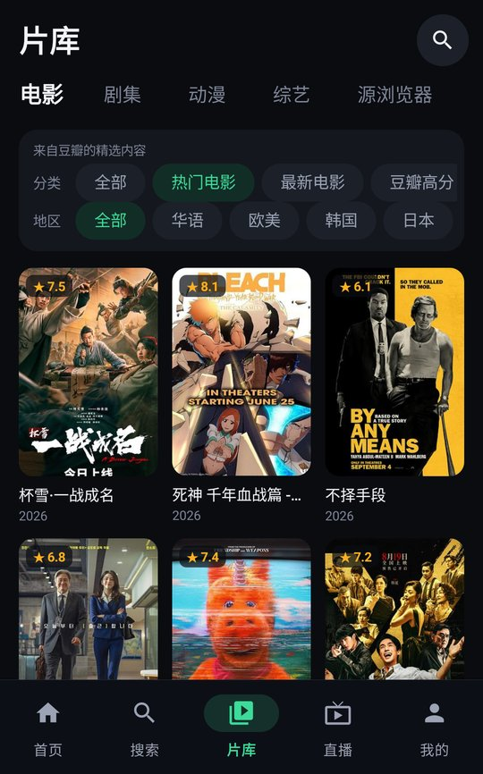
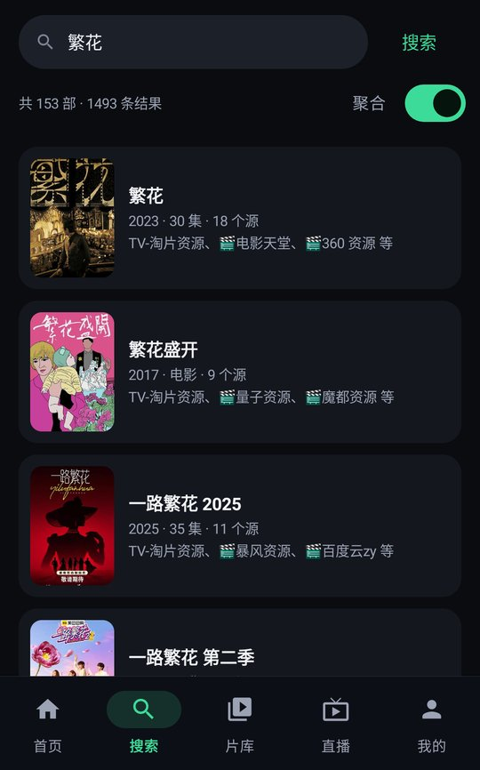
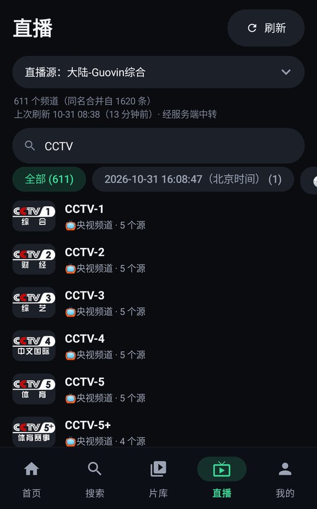
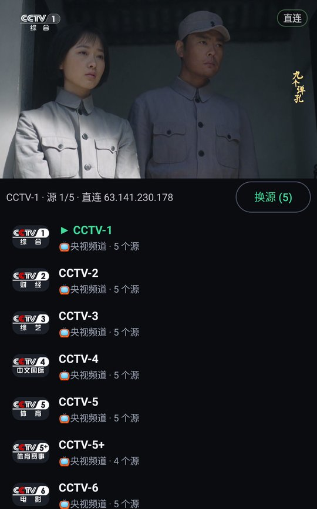
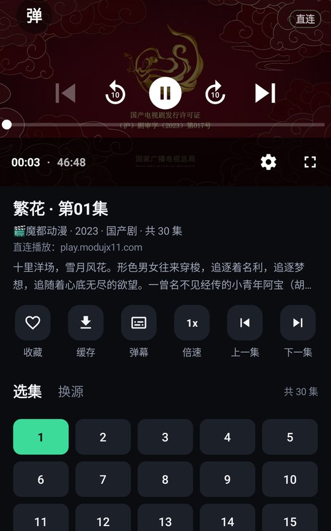

# DecoTV Android

> 服务端项目：[Fugitive844/DecoTV](https://github.com/Fugitive844/DecoTV)（由 [Decohererk/DecoTV](https://github.com/Decohererk/DecoTV) fork 而来）。本客户端需要连接一个自行部署的 DecoTV 服务端才能使用。

DecoTV 的原生安卓客户端，功能包括登录、注册、首页推荐、片库（电影 / 剧集 / 动漫 / 综艺 / 源浏览器）、搜索、点播（含弹幕）、离线缓存、直播、播放记录、收藏、搜索记录和修改密码。

## 运行截图

| 首页 | 片库 | 搜索 |
| --- | --- | --- |
|  |  |  |

| 电视直播 | 直播播放 | 点播 |
| --- | --- | --- |
|  |  |  |

支持深色、浅色和跟随系统三种外观：


## 功能概览

底部导航为：首页 / 搜索 / 片库 / 直播 / 我的。播放记录、收藏、搜索记录、离线缓存、设置、修改密码、退出登录都在「我的」里，以二级页面打开（标题栏和系统返回键都能返回）。

网页版受浏览器跨域和 HTTPS 混合内容的限制，很多视频只能经服务器中转。原生播放器没有这些限制，所以第三方资源默认由手机直连，不占用服务器带宽：

| 项目 | 直连 | 中转（服务端接口） |
| --- | --- | --- |
| 视频搜索 | 按服务端下发的源列表和过滤规则逐个请求视频源 | `/api/search/ws`；智能模式下直连失败的源走 `/api/proxy/cms` |
| 封面图片 | 图片站 | `/api/image-proxy` |
| 点播视频 | 视频源，网页型地址先经 `/api/playback/resolve` 解析 | resolve 返回的签名 `proxyUrl` |
| 直播频道列表 | 用直播源 UA 下载 m3u，在本地解析 | `/api/live/channels` |
| 直播流 | 用直播源 UA 直连 | `/api/proxy/m3u8`、`/api/proxy/stream` |
| 台标 | 直连 | `/api/proxy/logo` |

每一项都可以在「设置」里单独切换：不中转（默认）、全中转、智能（直连失败自动改走中转）。搜索默认智能；服务端的 `/api/server-config` 没有 `AdultTypeWords` 字段时（旧版服务端），搜索自动走服务端。logcat 的 `DecoNet` 标签会记录每个请求实际走的路径和主机。

## 首页与片库

数据与网页端同源：

- 首页：继续观看（播放记录）、热门电影、热门剧集、热门综艺（`/api/douban/categories`），新番放送（与网页端一样直接请求 `https://api.bgm.tv/calendar`，取今天的番）。每栏「更多」跳到片库对应分类。
- 片库的电影 / 剧集 / 动漫 / 综艺：筛选项、取值和默认值照搬网页端 `/douban?type=`。分类选「全部」（以及动漫的番剧 / 剧场版）时显示类型、地区、年代、平台、排序多级筛选，调 `/api/douban/recommends`；其余调 `/api/douban/categories`；动漫「每日放送」按星期取 Bangumi 数据。每页 25 条，滑到底自动加载。
- 点豆瓣 / Bangumi 海报：与网页端 `/play?title=&year=&stype=` 一样按标题搜索，取同名、同年份、同类型（电影单集 / 剧集多集）的第一个源播放；找不到就转到搜索页。
- 源浏览器：源列表 `/api/search/resources`（服务端开启成人过滤时隐藏成人源），分类与片单经 `/api/proxy/cms` 取原始 CMS 数据。片单自带分集地址时点开直接播放，否则按源和 id 查。比网页端多「在本源中搜索」（CMS 的 `wd` 参数）。
- 网页端的「自定义」分类只写在页面 HTML 里、没有接口，客户端暂不支持；网盘搜索暂未接入。

修改密码与网页端一致：数据库存储、非公开模式、不是站长时才显示，调 `POST /api/change-password {newPassword}`，成功后需重新登录。

## 播放

- 竖屏小窗播放，播放区至少占屏幕一半；转动手机或点全屏按钮进入全屏。竖版视频全屏时保持竖屏，全屏中右侧的旋转按钮可切换横竖屏。平板横屏时播放区与详情左右排列。
- 右上角角标显示当前是「直连」还是「中转」；缓冲时显示实时网速。
- 手势：左半屏上下滑调亮度（只改当前窗口），右半屏上下滑调音量，左右滑每档 5 秒快进快退，长按右半屏临时 2 倍速，双击暂停 / 继续。
- 控制栏的上一个 / 下一个对应上一集 / 下一集；默认倍速在「设置」中选择（0.5x～3x）。

## 弹幕

数据与网页端同源：`/api/danmu-external?title=&year=&episode=` 按标题、年份、集数自动匹配（空结果时带 `force=1` 再试一次），手动匹配用 `/api/danmu-external/search?keyword=` 选剧和集，再按 `episode_id` 加载。服务端的弹幕服务（huangxd-/danmu_api）只提供读取，所以客户端不支持发送弹幕。

- 画面左侧「弹」按钮：点按开关，长按打开设置；播放页「弹幕」按钮也能打开设置。
- 设置：不透明度、字号、速度、显示区域（1/4～全屏）、同屏数量、屏蔽滚动 / 顶部 / 底部、防重叠、屏蔽词、时间偏移（±0.5 秒），以及重新加载、手动匹配。手动匹配按「标题 + 年份」记住，换源和切集后沿用。
- 弹幕跟随媒体时间绘制：暂停时停住、倍速时跟着变快，拖动进度后从新位置开始。
- 离线缓存完成时一并保存这一集的弹幕，离线播放时读取。

## 离线缓存

播放页点「缓存」，选择剧集和保存格式（每次都可重新选择）。下载按「点播视频」的中转策略进行，默认直连；HLS 取最高码率，分片 4 路并发、断点续传，AES-128 加密的分片在本地解密后拼接。多个任务同时缓存，并发数在「设置 → 离线缓存并发数」调整（默认 5、最多 30）；转 MP4 一次只转一个，其余任务排队等转换。

| 格式 | 保存位置 | 说明 |
| --- | --- | --- |
| 加密（仅本 App） | App 私有目录 `files/offline/*.dtv` | 每个文件随机内容密钥（AES-CTR，可拖动进度），内容密钥由 Android Keystore 中不可导出的主密钥包裹；其他 App 无法读取，卸载后失效 |
| MP4 | 系统「影片/DecoTV」 | Media3 Transformer 转封装；编码不兼容 MP4 时自动转码为 H.264/AAC。转换失败时按原格式保存并提示 |
| 原格式 | 系统「影片/DecoTV」 | HLS 拼接为 TS（或 fMP4），直链保持原扩展名 |

缓存列表在「我的 → 离线缓存」，按影片分组。点按播放；长按可暂停 / 继续 / 重试、在线播放或删除。直连下载不经服务端去广告，需要去广告时可把点播视频设为「全中转」。

**边存边播**：m3u8 拿到分片列表后（工作目录的 `stream.json`）即可点按播放。播放器用本地播放列表 `dtvseg://任务id/index.m3u8`，已下载的分片读本地，没下载的由播放器自己下载、解密并存入缓存；下载线程优先下载播放位置之后的分片。缓存完成后在当前进度切到最终文件。MP4 等单文件下载完成前先在线播放。

HLS 拼接成的单个文件常有时间戳不连续（插播广告等），直接按文件播放时长会算错、无法拖动。所以缓存时记下每个分片在文件中的位置（`files/offline/*.layout.json`），本 App 播放时生成带 `EXT-X-BYTERANGE` 的播放列表。

## 构建

- JDK 17 以上，Android SDK 35，最低支持 Android 8.0（API 26）。
- 源码不内置任何服务器地址。默认构建的登录页服务器地址为空，由用户填写；可用 `-PappDefaultServer=...` 预置，例如本机联调时用 `http://10.0.2.2:13300`。
- 以下内容都在打包时传入，未传入时使用括号中的默认行为：
  - `-PappUpdateOrigin=`、`-PappUpdateChannel=`：升级服务地址（HTTPS）和渠道（不检查更新）
  - `-PappApplicationId=`：安装包名（`io.github.fugitive844.decotv`）
  - `-PappDeveloper=`、`-PappCopyrightOwner=`：关于信息中的开发者和版权方（DecoTV Android 贡献者）
- release 签名通过环境变量 `DECOTV_SIGN_STORE`、`DECOTV_SIGN_STORE_PASSWORD`、`DECOTV_SIGN_ALIAS`、`DECOTV_SIGN_KEY_PASSWORD` 注入。签名文件和发布配置不进入仓库。

```
gradlew :app:testDebugUnitTest :app:lintDebug :app:assembleDebug
```

## 联调测试

`app/src/androidTest` 中的测试面向一个真实的 DecoTV 服务端，账号通过运行参数传入，缺少参数时自动跳过：

```
adb shell am instrument -w -e class io.github.fugitive844.decotv.PlaybackFlowTest \
  -e liveBase http://10.0.2.2:13300 -e liveUser <用户名> -e livePassword <密码> \
  -e mode direct|relay|smart [-e expect relay -e blockThirdParty 1] \
  io.github.fugitive844.decotv.test/androidx.test.runner.AndroidJUnitRunner
```

`blockThirdParty` 只在 debug 包中生效：开启后，App 拒绝访问服务端以外的主机，用来验证智能模式的回退。

## 许可证

与服务端项目一致，采用 [CC BY-NC-SA 4.0](LICENSE)。
